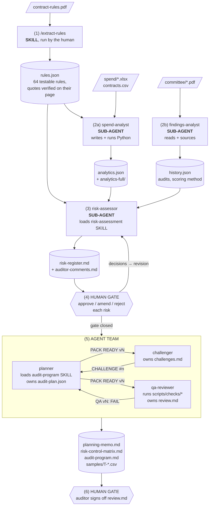
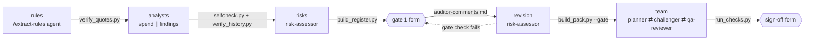

# Procurement Audit Planner: a Skills + Agents system

An agent system that plans an internal audit of a council's procurement from
its **public data**. It reads the purchasing rulebook, analyses every
published payment, folds in past audit history, rates the risks for a human
auditor to approve, and turns the approved risks into a checked audit
planning pack.

Built by following the step-by-step guide at
<https://procurement-audit-planner.vercel.app/> (5 lessons, 27 steps), using
the **Skills + Sub-agents + Human gate + Agent team** architecture. The data
is West Berkshire Council's own published material.

- **Part A** (sections 1–13): the system built and run inside Claude Code.
- **Part B** (section 14): the same system run by its own harness, a web app on
  `http://localhost:8000` with its own agent loop, tools, team messaging and
  gate forms. Quick start: `make setup`, `make run`. It runs on your Claude
  Code login, or on an API key in `.env`.

> **Indicators, not findings.** Everything this system produces describes
> patterns in public data to investigate. It plans an audit; it does not
> perform one, and it asserts no wrongdoing by the council, a department, an
> officer or a supplier.

**Contents**

1. [The problem](#1-the-problem)
2. [What it produces](#2-what-it-produces)
3. [Agent workflow](#3-agent-workflow)
4. [System architecture](#4-system-architecture)
5. [The skills](#5-the-skills)
6. [The agents](#6-the-agents)
7. [How they work together](#7-how-they-work-together)
8. [Design principles](#8-design-principles)
9. [Reusing this architecture in other projects](#9-reusing-this-architecture-in-other-projects)
10. [Repository layout](#10-repository-layout)
11. [Running it](#11-running-it)
12. [Guide completion record](#12-guide-completion-record)
13. [Results of this run](#13-results-of-this-run)
14. [Part B: the standalone harness (localhost web app)](#14-part-b-the-standalone-harness-localhost-web-app)

---

## 1. The problem

Planning a procurement audit is slow, manual and reading-based:

| Pain | Why it matters |
| --- | --- |
| **Slow** | A rulebook and years of committee papers take days to read. |
| **Random sampling misses risk** | 25 random payments out of ~10,000 almost never include the few that matter. |
| **Inconsistent** | Two auditors rate the same evidence differently; there is no fixed method. |
| **Patterns are invisible one at a time** | Split purchases, threshold-hugging and off-contract spend only appear when the *whole* population is analysed together. |

## 2. What it produces

An **audit planning pack**: what an auditor takes into fieldwork, every line
traceable to public data.

| File | What it is |
| --- | --- |
| `outputs/planning-memo.md` | One-page brief: purpose, data analysed, risks in scope and the auditor's decision on each, approach, rule coverage, limitations |
| `outputs/risk-control-matrix.md` | For each approved risk: the control the rules require, the rule it comes from, and the tests |
| `outputs/audit-program.md` | The fieldwork: per risk, objective → control → test step → evidence → the exact payments to pull (with their workbook row), ending with the request list for the council |
| `outputs/review.md` | QA results, verdict and the auditor's sign-off |

Intermediate, all inspectable: `rules.json` → `analytics.json` + `history.json` → `risk-register.md` → `auditor-comments.md` → `audit-plan.json` → the pack → `challenges.md` → `review.md`.

## 3. Agent workflow



| Stage | Who | Reads | Writes | Checked by |
| --- | --- | --- | --- | --- |
| 1. Rules | `extract-rules` skill (human runs `/extract-rules`) | contract-rules.pdf | `rules.json` | `verify_quotes.py`: every quote on its stated page, every clause accounted for |
| 2a. Spend | `spend-analyst` sub-agent | rules.json, spend workbooks, contracts.csv | `analytics.json`, `analytics-full/*.csv` | `selfcheck.py` re-derives one item per test |
| 2b. History | `findings-analyst` sub-agent | committee PDFs | `history.json` | `verify_history.py`: every quote on its stated page |
| 3. Risks | `risk-assessor` sub-agent + `risk-assessment` skill | rules, analytics, history | `risk-ratings.json` → `risk-register.md`, `auditor-comments.md` | `build_register.py`: every citation resolves, every figure filled by code |
| 4. Gate | **the auditor** | the register | decisions in `auditor-comments.md` | `build_register.py` refuses an unapplied or unrequested change |
| 5. Pack | agent team: `planner`, `challenger`, `qa-reviewer` + `audit-program` skill | approved risks, rules, analytics | `audit-plan.json` → memo, matrix, program, samples; `challenges.md`; `review.md` | `build_pack.py` + `scripts/checks/*` |
| 6. Sign-off | **the auditor** | review.md, challenges.md | sign-off block in `review.md` | QA verdict must be READY FOR SIGN-OFF |

## 4. System architecture

The system is built from five kinds of building block. The core lesson of
the guide is **choosing the right one for each job**:

| Building block | What it is in Claude Code | Use it when… | Here |
| --- | --- | --- | --- |
| **Project brief** | `CLAUDE.md`, read at the start of every session | the whole system needs one shared spec and non-negotiable rules | system flow, data sources, every component's spec |
| **Skill** | `.claude/skills/<name>/SKILL.md` (+ scripts beside it) | a *method* must be applied the same way every time, by a human (slash command) or loaded by an agent | `extract-rules`, `risk-assessment`, `audit-program` |
| **Sub-agent** | `.claude/agents/<name>.md` with its own tools, run in a fresh context | one job, independent of the conversation, that hands back one result (isolation keeps judgments independent and the main context small) | `spend-analyst`, `findings-analyst`, `risk-assessor` |
| **Human gate** | a decision file the system cannot fill for itself | a decision that is accountable to a person | `auditor-comments.md` (scope), `review.md` (sign-off) |
| **Agent team** | peer agents that message each other (`CLAUDE_CODE_EXPERIMENTAL_AGENT_TEAMS=1`) | work improves through back-and-forth between roles: drafting, challenging, checking | `planner`, `challenger`, `qa-reviewer` |

Plus two supporting layers that make the agents trustworthy:

| Layer | What it does |
| --- | --- |
| **Deterministic scripts** (`scripts/`, the `build_*.py` builders) | compute every number, draw every sample, render every document; the LLM never does arithmetic |
| **Verifiers** (`verify_*.py`, `selfcheck.py`, `scripts/checks/*`) | fail loudly when a quote is not in the source, a figure is not in the data, a citation does not resolve, or a rule is untraced |
| **Agent memory** (`.claude/agent-memory/<agent>/`) | per-agent *method* lessons (file quirks, pitfalls); never figures or findings |

### Why each piece is the kind of piece it is

- **`extract-rules` is a skill, not an agent**: it runs once, on one document, invoked by a person; it is a recipe, not an independent worker.
- **The analysts are sub-agents**: each reads large inputs (10,607 payments; 45 PDF pages) in its own context and returns only a summary file; their work is independent so they can run in parallel.
- **The risk-assessor is a sub-agent that loads a skill**: the *method* (rubric, citation rules, scoring) lives in the skill so it stays fixed; the agent only judges; isolation means two runs can be compared fairly.
- **The human gate is between rating and planning**: the system recommends; only the auditor decides scope.
- **The planning stage is a team, not three sub-agents**: the challenger's and QA's points go *back* to the planner, who must answer each one; that dialogue is the point.

## 5. The skills

| Skill | Invoked by | Purpose | Its script | Its test |
| --- | --- | --- | --- | --- |
| **`extract-rules`** | the human (`/extract-rules`) | Contract Rules PDF → `rules.json`: one entry per testable rule with clause, page, type (`threshold` / `approver` / `anti-avoidance` / `procedure`), scope, thresholds *as printed* with inclusive flags, required action, approver, evidence source and a verbatim quote. Named-but-unprinted thresholds ("the Threshold") go in `parameters` as `null`, never filled from memory. Every clause ends in `rules` or `excluded`; drafting gaps go in `notes`. | `verify_quotes.py`: schema, sequential IDs, declared parameters, each quote on its stated page, each £ figure printed in its quote, every printed clause covered | `tests/test_verify_quotes.py`: a real-quote fixture passes; 12 planted errors are each caught |
| **`risk-assessment`** | the `risk-assessor` agent | The rating method: a theme table, a likelihood rubric (so two runs agree), impact on the council's own scale, citation tags `[rule:]` `[metric:$.path]` `[history:]`, `{{$.path}}` placeholders for every figure, the repeat-finding uplift, and the revision protocol after the gate. | `build_register.py`: resolves citations, fills figures, scores L×I on the council's 5×5 matrix and RAG table, marks method conflicts, drops uncited risks, enforces revisions; writes the register and the decision template | `tests/test_build_register.py`: good vs broken risk, typed figure, false uplift, revision applied / unrequested change refused, idempotent rebuild |
| **`audit-program`** | the `planner` teammate | Turn approved risks into risk → expected control → test step → deterministic sample recipe → PBC list; memo text with placeholders only. | `build_pack.py`: gate check (`--gate`), scope vs plan, citations, samples drawn and verified against the spend data, rule coverage, renders the three documents and `pack-figures.json` | exercised by the team run and the QA checks |

## 6. The agents

| Agent | Kind | Tools | Owns | Never does |
| --- | --- | --- | --- | --- |
| **`spend-analyst`** | sub-agent | Bash, Read, Write, Edit, Glob, Grep | `scripts/clean.py`, `analyse.py`, `selfcheck.py`; `analytics.json`, `analytics-full/` | arithmetic itself; print full tables; edit `data/`; call a pattern wrongdoing |
| **`findings-analyst`** | sub-agent | Bash, Read, Write, Glob, Grep | `history.json` | score risks; fill gaps from general knowledge |
| **`risk-assessor`** | sub-agent (loads `risk-assessment`) | Bash, Read, Write, Edit, Glob, Grep | `risk-ratings.json` (the builder writes the register) | approve scope; type a figure; edit the decisions file |
| **`planner`** | team member (loads `audit-program`) | Bash, Read, Write, Edit, Glob, Grep | `audit-plan.json` (the builder writes the pack) | re-rate a risk; change scope; edit the register or builder |
| **`challenger`** | team member | Read, Write, Edit, Glob, Grep | `challenges.md` | edit the plan or pack; read raw `data/` |
| **`qa-reviewer`** | team member | Bash, Read, Write, Edit, Glob, Grep | `review.md` | fix anything; soften a result |

Each agent file states its inputs and outputs, its non-negotiable rules, its
procedure, its report format, and what it may save to memory.

## 7. How they work together

**Files are the contracts between stages.** Every stage reads named files and
writes named files; nothing passes through conversation memory. That makes
each stage re-runnable on its own and every output inspectable.

**Citations make judgments traceable.** Agents write judgments with tags, and
a deterministic builder resolves them:

```text
likelihood_justification:
  "{{$.tests.split_purchases.by_threshold.25000.headline_general_procurement.windows}} general-procurement
   windows … [metric:$.tests.split_purchases.by_threshold.25000.headline_general_procurement.windows]
   against the no-splitting rule [rule:CPR-20]"
```

`build_register.py` checks that `CPR-20` exists in `rules.json`, that the
metric path resolves to a scalar in `analytics.json`, fills the `{{…}}`
placeholder with the computed value, and drops the risk if a justification
has no resolvable citation. The agent cannot type a number.

**The judgment / computation split repeats at every stage:**

| Stage | LLM decides (writes JSON) | Script computes and checks |
| --- | --- | --- |
| Rules | which clauses are testable, how to classify them | quote-on-page, coverage, thresholds printed in quotes |
| Spend | how to write the analysis code | every count, total and flagged list |
| Risks | which risks, L and I scores, wording | resolution, figures, L×I, matrix label, band, revision diff |
| Pack | controls, tests, sample recipes, memo text | samples drawn, rows verified, rule coverage, rendering |

**Gates are files with checks.** `auditor-comments.md` holds one row per
risk; `build_register.py` will not produce a revision unless every recorded
decision is applied and nothing else changed, and `build_pack.py --gate`
will not let the team start until every risk is decided.

**The team runs on a message protocol.** `PACK READY vN` →
`CHALLENGE #n [type] R-xx` / `QA vN: FAIL <check>` → `RESPONSE #n:
accepted | declined | for the auditor` → rebuild → `PACK READY vN+1` …
→ `PLANNER DONE`, `CHALLENGER DONE`, `QA DONE` → the lead reports for
sign-off. Points about approved ratings or scope are marked *for the auditor*
rather than changed by the team.

## 8. Design principles

These hold at every stage (from `CLAUDE.md`):

1. **The LLM reads and judges; Python computes every number.**
2. **Everything is traceable**: quotes verified against the PDF page, metrics named and reproducible from a script, every rating cites a rule, a metric or a prior finding.
3. **Indicators, not accusations**: real council, real data; outputs describe patterns to investigate.
4. **Context discipline**: agents inspect data through `.head()`, `.info()` and aggregates; full lists go to files; JSON summaries carry top-20s and counts.
5. **Missing or malformed input → stop and report.** Never fabricate; a named-but-unprinted threshold stays `null`.
6. **Verifiers, not trust**: each stage ships with a script that fails loudly, and agents loop until it passes (they fix the output, never the check).
7. **Memory is for method only**: agents remember file quirks and pitfalls, never figures, ratings or decisions.

## 9. Reusing this architecture in other projects

The domain here is audit, but the pattern is general: **read sources →
compute evidence → judge with citations → human decides → team produces
and cross-checks a deliverable → human signs off.**

### Decision guide: which building block?

```text
Is it a decision a person must own?            → HUMAN GATE (a file + a check)
Is it a computation or a format/consistency check? → SCRIPT / VERIFIER (never the LLM)
Is it a fixed method applied the same way each run? → SKILL (+ its builder script)
   …run by a person once?                           → user-invoked skill (/name)
   …applied by an agent?                            → agent-loaded skill
Is it one job over large inputs that hands back one result? → SUB-AGENT
Does the output get better through argument between roles? → AGENT TEAM
```

### Template layout

```text
your-project/
  CLAUDE.md                     # problem, data sources, flow, principles, component specs
  data/                         # read-only inputs
  .claude/
    settings.json               # e.g. agent teams flag
    skills/<method>/SKILL.md    # the method …
    skills/<method>/build_*.py  # … and the script that enforces it
    skills/<method>/tests/      # fixtures with planted errors
    agents/<role>.md            # inputs, outputs, rules, procedure, report, memory
    agent-memory/<role>/        # method lessons only
  scripts/                      # deterministic analysis written by agents
  scripts/checks/               # QA checks run before sign-off
  outputs/                      # every intermediate and final artifact
```

### Checklist for a new project

1. Write `CLAUDE.md` first: problem, objectives, data sources with their quirks, the full flow, non-negotiable principles, a spec per component.
2. Profile the real data before building anything (step 1.4 found the header row moves between workbooks).
3. For each stage define the **output file and its schema**, then the **verifier**, then the agent or skill that produces it.
4. Make agents write **judgments with citations and placeholders**; make a script resolve and render them.
5. Test each verifier on a **fixture with planted errors** before trusting it.
6. Put a **human gate** wherever accountability matters, as a file the builder checks.
7. Use a **team** only where back-and-forth adds value; give it a written message protocol and a round limit.
8. Give every agent a **memory policy**: method yes, evidence never.

## 10. Repository layout

```text
procurement-audit-planner/
  CLAUDE.md                              # the brief (read every session)
  README.md
  requirements.txt                       # pandas, openpyxl
  data/                                  # public inputs, read-only
    contract-rules.pdf                   #   Contract Procedure Rules (15 pages)
    contracts.csv                        #   Contracts Finder notices export
    spend/Over500_2026_P0{2,3,4}_-_published.xlsx   # May–July 2026 payments over £500
    committee/*.pdf                      #   audit appendices, audit plan report, risk strategy
  .claude/
    settings.json                        # CLAUDE_CODE_EXPERIMENTAL_AGENT_TEAMS=1
    skills/
      extract-rules/   SKILL.md  verify_quotes.py   tests/
      risk-assessment/ SKILL.md  build_register.py  tests/
      audit-program/   SKILL.md  build_pack.py
    agents/
      spend-analyst.md  findings-analyst.md  risk-assessor.md   # sub-agents
      planner.md  challenger.md  qa-reviewer.md                 # agent team
    agent-memory/<agent>/MEMORY.md       # method lessons per agent
  scripts/
    clean.py  analyse.py  selfcheck.py   # written and run by the spend-analyst
    verify_history.py                    # findings-analyst's verifier
    checks/ run_checks.py check_quotes.py check_numbers.py check_trace.py check_samples.py
  outputs/                               # everything the system produced (see section 2)
  harness/                               # Part B: the standalone harness (section 14)
    app.py  pipeline.py  team.py  agent.py  tools.py  prompts.py  llm.py  sdk_backend.py  workspace.py  config.py
    static/index.html                    #   the web UI
  tests/test_harness.py                  # harness tests with a scripted model (no API calls)
  Makefile  .env.example                 # make setup | make run | make test
  runs/                                  # one isolated workspace per live run (git-ignored)
```

## 11. Running it

Prerequisites: Claude Code, Python 3.12, poppler (`pdftotext`, `pdfinfo`).

```bash
python3 -m venv .venv && .venv/bin/pip install -r requirements.txt
```

Then in Claude Code, in this folder, the stages are:

```text
/extract-rules                                   # stage 1 (skill)
Run the spend-analyst.                           # stage 2a (sub-agent)
Run the findings-analyst.                        # stage 2b (sub-agent)
Run the risk-assessor.                           # stage 3 (sub-agent + skill)
  → record decisions in outputs/auditor-comments.md, then "Run the risk-assessor again."
Run the agent team for the audit planning pack.  # stage 5 (team; needs Claude Code ≥ 2.1.224)
  → sign off at the end of outputs/review.md
```

Every check can be re-run by hand:

```bash
.venv/bin/python .claude/skills/extract-rules/verify_quotes.py outputs/rules.json data/contract-rules.pdf
.venv/bin/python scripts/selfcheck.py
.venv/bin/python scripts/verify_history.py outputs/history.json data/committee
.venv/bin/python .claude/skills/risk-assessment/build_register.py
.venv/bin/python .claude/skills/audit-program/build_pack.py --gate
.venv/bin/python scripts/checks/run_checks.py
# skill tests
.venv/bin/python .claude/skills/extract-rules/tests/test_verify_quotes.py
.venv/bin/python .claude/skills/risk-assessment/tests/test_build_register.py
```

## 12. Guide completion record

All 27 steps of the guide were completed in order. Where the guide offered
"ask Claude to write it" (Option 1) or "copy the finished file" (Option 2),
the choice is recorded.

| Step | What | How |
| --- | --- | --- |
| 1.1–1.5 | Folder, `CLAUDE.md`, data, `.venv`, project folders | done; data profiled with aggregates only |
| 2.1 | Build `extract-rules` | written by Claude after reading the PDF (plain + layout); verifier tested on 12 planted errors |
| 2.2 | Run `/extract-rules` | 64 rules, 69 excluded clauses, 4 null parameters, 16 notes; verifier passes |
| 3.1–3.2 | Build and run `spend-analyst` | copied the guide's finished agent; run as a sub-agent |
| 3.3–3.4 | Build and run `findings-analyst`, check items against rendered PDF pages | copied the guide's finished agent + `verify_history.py`; 136/136 quotes verified; opinion and band checked against page images |
| 3.5 | Build `risk-assessment` skill | written by Claude (the guide offers only this option); builder tested on a good and a broken risk |
| 3.6–3.7 | Build and run `risk-assessor`; rerun the builder; check no supplier names in risk text | guide's agent; 11 risks rated, 0 failures, 0 warnings |
| 4.1–4.3 | Human gate: decision template, decisions, revised register | approve / amend / reject recorded → revision 1 |
| 5.1 | Close the gate | remaining risks approved → revision 2; `build_pack.py --gate` passes |
| 5.2 | Enable agent teams | `.claude/settings.json` |
| 5.3–5.6 | `audit-program` skill, `planner`, `challenger`, `qa-reviewer`, the four checks | copied the guide's finished files |
| 5.7 | Run the team | 3 pack versions, 11 challenges, QA 4/4 pass (section 13) |
| 5.8 | Sign off | recorded in `review.md` (drafted by Claude on the owner's instruction, marked for confirmation) |

### Deviations from the guide, and why

| Deviation | Why |
| --- | --- |
| `CLAUDE.md` and `spend-analyst.md`: the council-name filter on `contracts.csv` is **case-insensitive** | the export spells the buyer three ways, including `WEST BERKSHIRE COUNCIL`; an exact match would drop 6 of the council's 141 notices |
| High-value / off-contract tier uses the **£25,000 publication threshold**, not the lowest (£1,000) quote threshold | every supplier in an over-£500 population exceeds £1,000 once annualised, so the literal tier selects everyone; recorded as an auditor decision |
| `analyse.py` joins `row_ids` with `; ` | `build_pack.py` splits sample row lists on `;` or `,`; found by the planner during the team run |
| Gate decisions were **drafted by Claude on the owner's instruction** and are marked so in `auditor-comments.md` | the owner delegated the run; the Reviewer line records it so a human can confirm or change them |
| Agent team run with the **lead relaying messages** between the three teammates | agent teams need Claude Code ≥ 2.1.224; the installed version was 2.1.145. Teammates were spawned from their own `.claude/agents/*.md` files and every protocol message was passed on verbatim |

## 13. Results of this run

All figures below are read from the output files; none were typed by an agent.

**Stage 1, rules** (`rules.json`): 64 testable rules (27 approver, 24 procedure, 12 threshold, 1 anti-avoidance), 69 clauses excluded with reasons, 4 named thresholds left `null` (the PDF never prints "the Threshold"), 16 drafting notes (e.g. exactly £500,000 falls in no band; 7.2.2 vs 7.3 on who may grant an exception).

**Stage 2, evidence**
- `analytics.json`: 10,607 payments (1 May – 31 Jul 2026); 8,534 analysed after excluding redacted payees, pension contributions and inter-authority payments; six tests (threshold clustering, split purchases, high-value suppliers / off-contract, duplicates, expired notices, spend vs award). Self-check 7/7.
- `history.json`: 20 audits with opinions, the council's 5×5 scoring method (scales, matrix, RAG bands, appetite), 12 discrepancies in the papers recorded, not resolved; 136/136 quotes verified.

**Stage 3, register** (`risk-register.md`): 11 risks rated on the council's own scale, every justification citing a rule, a metric or an audit; the header marks the Corporate Risk Register conflict (Figure 4 "score 9 or above" vs Table 4 "15–25").

**Stage 4, gate** (`auditor-comments.md`): R-01 approved, R-07 amended into scope, R-10 rejected (revision 1); the rest approved (revision 2). Scope: **9 risks in scope**, R-09 approved as rated but out of scope, R-10 rejected.

| ID | Risk | Score | Band | Scope |
| --- | --- | --- | --- | --- |
| R-01 | Payments to one supplier grouped under a procedure threshold | 12 | Medium - High | in |
| R-02 | Single payments sitting just below a quote or tender threshold | 12 | Medium - High | in |
| R-03 | High-value suppliers with no matching published contract notice | 12 | Medium - High | in |
| R-04 | Payments continuing after a published contract notice ended | 9 | Medium - High | in |
| R-05 | Spend running above the published award value | 9 | Medium - High | in |
| R-06 | Repeated payments of the same amount to the same supplier | 9 | Medium - High | in |
| R-07 | Waivers and exceptions to competition not approved or recorded | 4 | Moderate | in (amended) |
| R-08 | Award approval and Key Decisions for the largest contracts | 12 | Medium - High | in |
| R-09 | Care and education placements bought outside competition | 6 | Moderate | out |
| R-10 | Grants and transfer payments that may be contracts | – | – | rejected |
| R-11 | Agency staff bought without a competed contract | 8 | Medium - High | in |

**Stage 5, team** (three pack versions):

| | v1 | v2 | v3 |
| --- | --- | --- | --- |
| Planner | built after one blocker was fixed (sample row lists) | answered 8 challenges | answered 3 challenges, `PLANNER DONE v3` |
| Challenger | 8 challenges | verified, 3 more | verified, all closed: 10 resolved, 1 *for the auditor*; `CHALLENGER DONE` |
| QA | 3/4 (challenges.md missing) | 3/4 (challenges open) | **4/4 PASS, READY FOR SIGN-OFF**; `QA DONE` |

Final pack: 9 risks, 11 controls, 16 tests, **238 sampled transactions** (each verified against its row in the council's workbook), 39 of 64 rules cited and the other 25 listed as not tested with a reason, 21 items on the request list for the council.

**Stage 6, sign-off** (`review.md`): signed off, with challenge #2 (placements, about 46% of analysed spend by the figures in `analytics.json`, out of scope) answered: kept out of scope and proposed for a separate review. Drafted by Claude on the owner's instruction and marked for the owner to confirm.

### Lessons the run surfaced

- Testing on fixtures and running the team caught real defects before they reached the pack: a verifier that turned one malformed rule into a second, false coverage failure; a revision rebuild that would have failed on re-run; and a separator mismatch between two components (`row_ids`) that the planner reported as `PLANNER BLOCKED` instead of working around.
- The challenger changed the plan materially (e.g. the largest suppliers had been excluded from the award-approval test; the spend-vs-award sample missed the two largest flagged suppliers).
- Points about approved scope were routed to the auditor, not changed by the team, exactly as designed.

## 14. Part B: the standalone harness (localhost web app)

Part A depended on Claude Code: it ran the agent loop, the tools, the
sub-agents, the team messaging and the permission prompts. Part B replaces
all of that with a small harness of our own, so the whole workflow runs from a
web page without Claude Code. **Scope:** it runs on your machine at
`http://localhost:8000`; it is not deployed to a public URL. (The assignment
text asks for an independently *deployed* app; the owner chose localhost.
Section 14.7 notes what a hosted deploy would add.)

### 14.1 Run it

```bash
make setup          # .venv + requirements (pandas, openpyxl, anthropic, claude-agent-sdk, fastapi, uvicorn, pytest), creates .env
make run            # http://localhost:8000
make test           # harness tests (scripted model, no API calls) + the skill tests
```

**Which model backend runs the agents** (chosen automatically; the header shows it):

| Backend | Needs | How the model is called |
| --- | --- | --- |
| `api` | `ANTHROPIC_API_KEY` in `.env` | the harness's own Messages-API tool loop (`agent.py`, `llm.py`) |
| `claude-code` | the `claude` CLI installed and signed in (no key) | the Claude Agent SDK on your Claude Code login (`sdk_backend.py`), with Claude Code's built-in tools switched off, project settings not loaded, the harness system prompt, and only the harness tools (served from an in-process MCP server) |

`HARNESS_BACKEND=api` or `=claude-code` in `.env` forces one. Either way the
harness owns the pipeline, the prompts, the tools and their sandbox rules, the
team mailbox and the gates; only the model call differs.

The page opens on **Part A run (demo)**: the completed run from this repo,
browsable without a key (every output rendered: register, memo, matrix,
program, samples, challenges, review). With a key, **Start run** launches a
live run; choose where it starts:

| Start at | What runs live | Earlier inputs come from |
| --- | --- | --- |
| 1. Extract rules | everything, 6 stages | nothing (full run) |
| 2. Analysts | spend-analyst + findings-analyst onward | Part A `rules.json` |
| 3. Risk register | risk-assessor onward (good demo: reaches both gates) | Part A rules, analytics, history |
| 5. Agent team | planner / challenger / qa-reviewer, then sign-off | Part A approved register |

### 14.2 What the harness does, mapped to Part A

| Part A (Claude Code) | Part B (this harness) | Where |
| --- | --- | --- |
| Claude Code's agent loop | `api`: a manual Messages-API tool-use loop per agent (`claude-opus-5-5`, adaptive thinking, streamed, prompt caching, server-side refusal fallback). `claude-code`: one Agent SDK session per agent, resumed turn to turn | `agent.py`, `llm.py`, `sdk_backend.py` |
| `.claude/agents/*.md` | read at run time: the body becomes the system prompt (with `CLAUDE.md` and the agent's `MEMORY.md`); the `tools:` frontmatter decides which tools it gets | `prompts.py` |
| Skills (`/extract-rules`, loaded skills) | `/extract-rules` runs as an agent whose role is the `SKILL.md`; agents read their skills from the workspace as before | `prompts.py`, `pipeline.py` |
| Read / Write / Edit / Glob / Grep / Bash | `read_file`, `write_file`, `edit_file`, `list_files`, `grep`, `run`, scoped to the run's workspace | `tools.py` |
| "never edit data/, the skills or the checks" (instructions) | **enforced**: writes to `data/`, `.claude/agents|skills/`, `scripts/checks/`, `verify_history.py`, `CLAUDE.md` are refused; paths cannot leave the workspace; commands run without a shell from an allow-list | `tools.py` |
| Sub-agents in fresh contexts | each agent is its own conversation; the two analysts run in parallel threads | `pipeline.py` |
| Agent team (experimental flag) | **real peer messaging**: a `send_message` tool delivers into the recipient's inbox; an agent runs whenever it has mail; the lead records `… DONE`, tells the qa-reviewer when the others are done, nudges a silent teammate once, and stops when all three report done | `team.py` |
| Human gate in a markdown file | a web form per risk (approve / amend / reject + comment) that writes `auditor-comments.md`, then the risk-assessor revises and `build_pack.py --gate` must pass | `pipeline.py`, `static/index.html` |
| Sign-off line in `review.md` | a sign-off form that fills the block | same |
| Verifiers run by agents | also run **by the harness** after each stage; a stage only passes if its verifier passes | `pipeline.py` |
| Session transcript | `runs/<id>/events.jsonl` streamed to the page (server-sent events): thinking summaries, tool calls, results, messages, verifier output | `app.py` |

### 14.3 Pipeline



Every run gets an isolated workspace, `runs/<id>/`: a copy of the brief,
data, agents, skills, agent memory and verifier scripts, with `.venv` linked.
The repository itself is never written to by a run. Run state lives in
`runs/<id>/run.json`, so the page can reconnect at any time; a server restart
marks an in-flight run as interrupted instead of pretending it is running.
One live run works at a time (a run waiting at a gate does not block others).

### 14.4 The team, as implemented

```text
planner ──PACK READY v1──▶ challenger, qa-reviewer
challenger ──CHALLENGE #n──▶ planner        qa-reviewer ──QA v1: FAIL …──▶ planner
planner ──RESPONSE #n / PACK READY v2──▶ …   (two challenge rounds at most, per the agent files)
planner ──PLANNER DONE──▶ lead ─(relays)─▶ qa-reviewer
challenger ──CHALLENGER DONE──▶ lead ─(relays)─▶ qa-reviewer
qa-reviewer writes review.md ──QA DONE──▶ lead  →  harness runs run_checks.py  →  sign-off form
```

The lead never edits a message and passes on only the two DONE notices the
qa-reviewer's protocol depends on. This is the agent-team behaviour Part A
had to imitate by relaying (Claude Code 2.1.145 lacked agent teams).

### 14.5 Tests

`tests/test_harness.py` drives the real harness with a **scripted model**
(canned responses per agent), so it needs no key and costs nothing:

- the sandbox refuses writes to protected paths, path escapes, pipes and
  programs off the allow-list; tool inputs are validated against their schema;
- a workspace is a copy, and the repo is untouched;
- peer messages flow planner → challenger/qa → planner → lead, and the
  qa-reviewer is told when the others are done;
- the full gate path: gate-1 form validation (every risk decided; amend and
  reject need a comment) → revision → `build_pack.py --gate` → team →
  `run_checks.py` (4/4) → sign-off written to `review.md`;
- the web API serves the demo run and blocks path traversal.

The real SDK request (model, adaptive thinking, effort, streaming, caching,
refusal fallback, tool schemas) was also checked to be accepted by the
installed `anthropic` SDK.

### 14.6 Cost and time

A live run calls `claude-opus-5-5` for every agent step: billed to the API key
on the `api` backend, or counted against your Claude Code plan's usage on the
`claude-code` backend (the SDK still reports a notional dollar figure). The
stage-3 run in 14.8 took about 25 minutes. Starting at stage 3
runs the risk-assessor twice plus the three-member team; a full run adds the
rules extraction and both analysts (the spend-analyst writes and runs its own
analysis code). Expect tens of minutes and a meaningful API bill for a full
run; start at stage 3 for a demonstration. `HARNESS_MODEL`, `HARNESS_EFFORT`
and `HARNESS_MAX_TURNS` in `.env` tune this.

### 14.7 Limits

- **Local only.** The `run` tool and agent-written Python execute on your
  machine; the allow-list and path checks are guard rails for local use, not
  a sandbox for untrusted users. A public deploy would need a per-run
  container (or Managed Agents' hosted sandbox), authentication, rate limits
  and a server-side key; none of that is built.
- **Runs are not deterministic.** A live rerun rates some risks differently
  from Part A (see 14.8); the method, citations and checks hold, the
  judgments vary within them. That is what the gates are for.

### 14.8 Live run (2026-10-17, `claude-code` backend, no API key)

Started at stage 3 from the web app's API, with the gates answered through
the same endpoints the forms use (signed "Live test (Claude, on Frank Fu
instruction)"). Evidence, including the full event log, is in
[`docs/live-run-2026-10-17/`](docs/live-run-2026-10-17/).

| Step | Result |
| --- | --- |
| risk-assessor (live) | 11 risks rated; `build_register.py`: 0 failures, 0 warnings (~5 min) |
| gate 1 form | 11 decisions: 9 approve, R-07 amend into scope, R-10 reject |
| revision + gate check | revision 1 applied; `build_pack.py --gate` closed; 10 risks in scope |
| agent team (live, peer messaging) | 12 deliveries, 27 messages, pack v1 → v4; 9 challenges over 2 rounds (8 resolved, 1 *for the auditor*: the R-09 rating); QA re-ran on every version (~19 min) |
| harness QA run | `run_checks.py` 4/4 PASS: 10 risks, 11 controls, 17 tests, 329 sampled transactions, 43/64 rules cited |
| sign-off form | recorded in `review.md`; run status `done` |

Compared with Part A, the independent rerun rated R-05 at 12 (was 9) and R-09
at 8 and in scope (was 6 and out); the team then challenged the R-09 rating
and passed it to the auditor rather than changing it.
